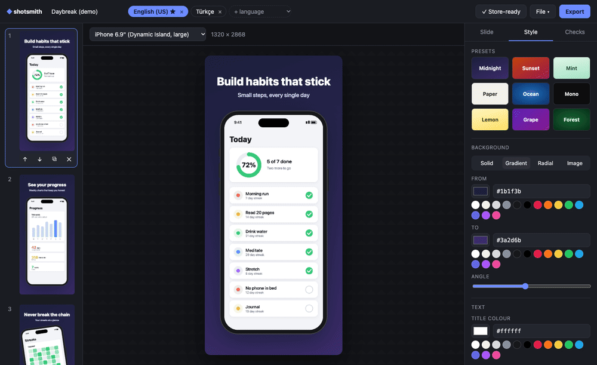
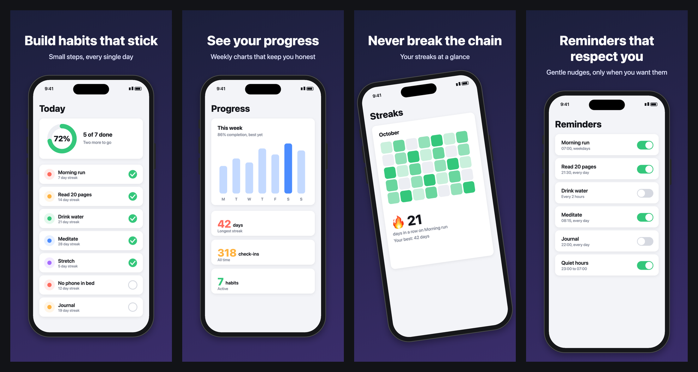
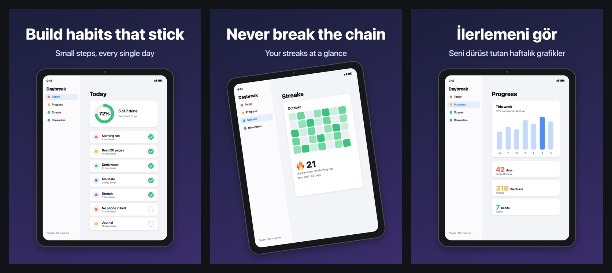

# shotsmith

**App Store and Google Play screenshots, made in your browser.** Drop in raw
screenshots, add a headline, pick colours, and export every size both stores
ask for, in every language, laid out for fastlane. Nothing is uploaded:
there's no server and no account. It's a static page.

**[Open shotsmith →](https://servanklc93-cmd.github.io/shotsmith/)**



| iPhone 6.9" | iPad 13" |
| --- | --- |
|  |  |

*Every image above came straight out of the exporter (the app is a made-up demo).*

## Why

Every release needs the same thing: 5–10 marketing screenshots, at three or
four sizes, times every language you ship. The options are a Figma template
you resize by hand, a paid SaaS that wants your screenshots on its servers, or
a fastlane `frameit` setup that takes an afternoon. shotsmith does the job in
a browser tab.

## What it does

- **Every size the stores ask for** (2026 rules): iPhone 6.9" (1320×2868),
  6.3" (1206×2622, required), 6.5" (1284×2778), iPad 13" (2064×2752), Google
  Play phone (1080×1920) and 10" tablet (1620×2880).
- **Real iPad output.** iPad and Android tablet sizes use their own
  screenshots. A phone screenshot is never stretched into an iPad frame;
  shotsmith tells you when a tablet screenshot is missing instead.
- **Pick any colour**: background (solid, linear, radial, or your own photo
  with a darken slider), title and subtitle colour, all with a picker, a hex
  box and quick swatches. Per-slide overrides when one screenshot needs to
  stand out. Nine presets to start from.
- **Localisation built in.** 20 store languages, a caption per language,
  per-language screenshots when the UI differs, right-to-left layout for
  Arabic and Hebrew.
- **Store checks before you upload**: missing required sizes, too many or too
  few screenshots, captions covering more than 20% of a Play image, contrast
  below WCAG levels (measured against your background photo too), screenshots
  that aren't shaped like the device they're framed in.
- **fastlane-ready zip**: `fastlane/screenshots/<locale>/NN_<size>.png` for
  `deliver` and `fastlane/metadata/android/<locale>/images/...` for `supply`.
  PNGs are RGB with no alpha channel, which App Store Connect insists on.
- **Device frames drawn in code** (iPhone with Dynamic Island, iPad, Android),
  or none. Google asks for none, so that's the default for Play sizes.
- **Projects stay yours**: autosaved in the browser (IndexedDB), and saved as a
  single `.shotsmith` file you can commit next to your app.
- Undo/redo, drag and drop anywhere, paste from the clipboard.

## How it's built

TypeScript with no framework and no runtime dependencies. One canvas renderer
draws both the preview and the export, so what you see is what you upload.

| file | what's in it |
| --- | --- |
| `src/specs.ts` | store sizes, limits, locales, fastlane paths |
| `src/layout.ts` | pure geometry: text wrapping and fitting, device placement |
| `src/render.ts` | canvas drawing: backgrounds, frames, captions |
| `src/lint.ts` | the store checks, WCAG contrast |
| `src/png.ts` | an RGB PNG encoder (per-row filter choice, `CompressionStream` deflate) |
| `src/zip.ts` | a zip writer and reader (stored entries, UTF-8 names) |
| `src/export.ts` | export plan and zip |
| `src/ui/` | the editor |

The PNG encoder exists because `canvas.toBlob()` always writes an alpha
channel, and App Store Connect rejects screenshots that have one.

```bash
npm install
npm run dev        # rebuilds into site/ on change; serve site/ with any static server
npm test           # vitest
npm run typecheck
npm run build
```

## Store rules, briefly

| | App Store | Google Play |
| --- | --- | --- |
| screenshots | 1–10 per size | 2–8 phone |
| required | iPhone 6.3"; 6.9" or else 6.5" | phone |
| format | PNG/JPEG, no alpha | PNG/JPEG, no alpha, longest side ≤ 3840, ratio ≤ 2:1 |
| text | | caption ≤ 20% of the image, no device frames recommended |

## License

MIT
